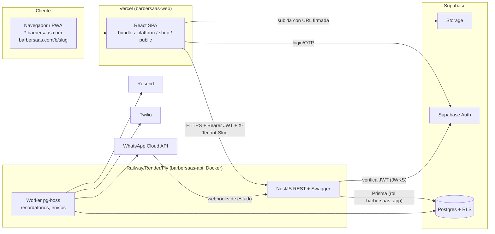

# BarberSaaS — Propuesta de arquitectura (para aprobación)

> Estado: **aprobado (2026-11-06)**, con los cambios de abajo.
> Alcance detallado: **Fase 1 (MVP)**. Las fases 2–4 aparecen solo donde afectan decisiones de hoy.

### Cambios tras la revisión
- **Sin Supabase por ahora:** solo Postgres local (docker-compose).
  - Auth: proveedor **local** en la API (email/contraseña con argon2, JWT de acceso HS256 y refresh tokens rotativos en `auth_sessions`), detrás de una interfaz `AuthProvider`. Supabase (D9) queda como segundo adaptador para más adelante.
  - Storage: adaptador de **disco local** (`STORAGE_DRIVER=local`) detrás de `StorageProvider`.
  - D2 sigue aplicándose: la migración revoca permisos a `anon`/`authenticated` solo si esos roles existen.
- **Sin repos git todavía:** las carpetas `barbersaas-api/` y `barbersaas-web/` se crean sin `git init`.
- **Calendario:** react-big-calendar.
- **RLS (§4):** además de `superadmin` y `support`, existe el contexto `system` para procesos internos (auth, worker, webhooks, alta self-service). Sustituye a las funciones `SECURITY DEFINER`, como `resolve_public_shop`. `support` solo tiene lectura en las tablas de plataforma.
- **Cola de tareas (D4, cambio en el paso 9):** en lugar de pg-boss, la tabla `message_logs` hace de cola (inserción transaccional con la cita, worker con `FOR UPDATE SKIP LOCKED`, reintentos con backoff). Menos piezas y garantía transaccional; se puede migrar a Inngest/pg-boss detrás de la misma interfaz si el volumen lo exige.
- **Enlace de gestión de citas:** HMAC del id de la cita en lugar de un token guardado (se regenera en cada recordatorio).
- **Versiones:** NestJS 11 (nestjs-zod aún no soporta Nest 12), Prisma 7 con `@prisma/adapter-pg`, Zod 4, Node 24.

---

## 0. Decisiones clave (lo que resolví donde el pedido era ambiguo)

| # | Tema | Decisión | Por qué |
|---|------|----------|---------|
| D1 | Cómo conviven Prisma y RLS | El API se conecta con un rol propio `barbersaas_app` (**sin** `BYPASSRLS`). Cada request abre una transacción y ejecuta `set_config('app.barbershop_id', …, true)`, `app.user_id`, `app.platform_role`. Las políticas RLS leen esos valores. | `auth.uid()` de Supabase solo existe cuando se entra por PostgREST; Prisma entra por conexión directa. Así RLS sigue siendo una 2ª capa real aunque haya un bug en el guard. Funciona con el pooler de Supabase en modo transacción (`is_local = true`). |
| D2 | PostgREST de Supabase | El frontend **nunca** consulta la BD directamente. Se revocan todos los permisos de `anon` y `authenticated` sobre las tablas del negocio. Supabase se usa solo para **Auth** y **Storage**. | Evita que alguien con la anon key lea tablas por `/rest/v1`. Una sola puerta: la API. |
| D3 | Evitar dobles reservas | **Exclusion constraint** en Postgres (`btree_gist`): `EXCLUDE (staff_id WITH =, tstzrange(start_at, end_at_with_buffer) WITH &&)` para citas activas. Además `SELECT … FOR UPDATE` sobre el barbero al crear la cita. | La BD garantiza que nunca haya dos citas superpuestas aunque lleguen dos requests en el mismo milisegundo. El lock solo da un mensaje de error más amable. |
| D4 | Jobs / colas | **pg-boss** (cola sobre el mismo Postgres) + su scheduler para tareas periódicas. | No añade infraestructura (sin Redis ni SaaS externo), es transaccional y sirve para recordatorios y reintentos. Si más adelante hace falta, se cambia a Inngest/Trigger.dev detrás de la misma interfaz `JobQueue`. |
| D5 | Cifrado de secretos | AES-256-GCM en la aplicación, con clave maestra en `ENCRYPTION_KEY` y versión de clave guardada junto al dato (rotación posible). | Portable (sirve igual en local y en Supabase), sin depender de Vault. |
| D6 | Cliente de API en el frontend | **Orval** genera tipos + hooks de TanStack Query + esquemas Zod a partir del `openapi.json` del backend. | Un solo comando (`pnpm api:gen`) mantiene el frontend sincronizado; el frontend no importa nada del backend. |
| D7 | Página pública y SEO | **Fase 1:** la página pública es un bundle separado de la misma SPA (`/b/:slug`), con `<title>`/meta dinámicos (React 19) y un endpoint de la API `GET /public/og/:slug` que devuelve HTML con las meta tags para los crawlers de WhatsApp/Facebook (el hosting reescribe los bots hacia ahí). **Fase 3:** mini proyecto Astro SSR (`barbersaas-public`) con caché en el edge. | Los slugs son dinámicos, así que el SSG puro no sirve. Lo que más importa en el MVP es la vista previa al compartir el enlace por WhatsApp, y eso se resuelve sin un tercer repo. |
| D8 | Desarrollo local de Auth | `docker-compose.yml` = API + Postgres (como se pidió). Para Auth/Storage en local se usa **Supabase CLI** (`supabase start`) o un proyecto Supabase de desarrollo. Los tests de integración firman JWTs con el secreto local, sin depender de Supabase. | Supabase Auth no corre en un Postgres normal. Así los tests siguen siendo herméticos. |
| D9 | Validación JWT | Se verifica con el **JWKS** de Supabase (claves asimétricas), con fallback a HS256 (`SUPABASE_JWT_SECRET`) para proyectos antiguos. | Es el modo recomendado actualmente por Supabase. |
| D10 | Permisos granulares | Rol base (en `memberships.role`) + matriz de permisos por defecto en código + **overrides por barbería** (`barbershop_settings.permissions`) + overrides por miembro (`memberships.permissions`). Guard `@RequirePermission('customers.view_phone')`. | Configurable por barbería sin crear tablas de permisos dinámicas en el MVP. |
| D11 | Restricción "el barbero solo ve lo suyo" | Se aplica en la **capa de aplicación** (guard + filtros del servicio), no en RLS. RLS solo garantiza el aislamiento **entre barberías**. | Las políticas RLS por rol dentro del tenant se vuelven frágiles y difíciles de testear; el aislamiento entre tenants es lo crítico. |
| D12 | WhatsApp y plantillas | Los mensajes que inicia la empresa (confirmación, recordatorio) **requieren plantillas aprobadas por Meta**. Cada plantilla editable de la barbería se registra en su WABA vía Graph API y guardamos su estado (`pending/approved/rejected`). Con el número de la plataforma se usan plantillas globales aprobadas. Fallback: enlace `wa.me` prellenado. | Es una restricción de Meta: un texto libre editado por la barbería no se puede enviar fuera de la ventana de 24 h. |
| D13 | Gestor de paquetes / runtime | pnpm, Node 22 LTS en Docker (en local tienes Node 20, que también funciona). | Estándar actual. |
| D14 | Pagos de suscripción en Fase 1 | Interfaz `PaymentGateway` + adaptador **manual** (el superadmin marca la factura como pagada). El cobro automático (Mercado Pago/Culqi/Stripe) y el dunning van en la Fase 2, como indica el plan. | Coincide con el alcance de la Fase 1 sin cerrar el diseño. |

---

## 1. Arquitectura general



- **Un solo despliegue del backend**, con dos procesos a partir de la misma imagen: `api` (HTTP) y `worker` (jobs). Se elige con `APP_MODE=api|worker`.
- **Arquitectura modular** en NestJS: cada módulo de dominio tiene `controller → service → repository (Prisma)`, más DTOs con Zod (`nestjs-zod`, que también genera el OpenAPI). Las integraciones externas van detrás de puertos/adaptadores (`MessagingProvider`, `PaymentGateway`, `EmailProvider`, `StorageProvider`).

### Ciclo de vida de un request

```
Request
 └─ RateLimitGuard (solo /public/*)
 └─ AuthGuard            → verifica JWT → req.user = { id, email }
 └─ TenantGuard          → resuelve X-Tenant-Slug → barbershop
                           → valida membership (o rol de plataforma/impersonación)
                           → req.tenant = { barbershopId, role, permissions }
 └─ PermissionsGuard     → @RequirePermission(...)
 └─ PlanLimitsGuard      → @EnforceLimit('staff') en los endpoints de creación
 └─ Controller → Service
       └─ prisma.$tenant(ctx, tx => ...)   ← transacción con set_config(...) → RLS activo
 └─ AuditInterceptor     → audit_logs en acciones marcadas @Audit()
```

Tipos de rutas:

| Prefijo | Auth | Tenant | Uso |
|---------|------|--------|-----|
| `/v1/platform/*` | JWT + rol de plataforma | no | Superadmin / soporte |
| `/v1/shop/*` | JWT + membership | `X-Tenant-Slug` | Panel de la barbería y del barbero |
| `/v1/public/:slug/*` | opcional | por slug en la URL | Página pública, disponibilidad, reservar |
| `/v1/me/*` | JWT | no | Perfil, mis barberías, mis citas (cliente final) |
| `/v1/webhooks/*` | firma HMAC | no | WhatsApp, pasarelas de pago |

### Resolución del tenant en el frontend

```
hostname = "elbarbas.barbersaas.com"  → slug = "elbarbas"           (panel/página)
hostname = "reservas.elbarbas.pe"     → GET /v1/public/resolve-domain → slug   (Fase 3)
path     = "/b/elbarbas"              → slug = "elbarbas"           (página pública)
hostname = "app.barbersaas.com"       → selector de barbería (usuarios con varias)
hostname = "admin.barbersaas.com"     → panel de plataforma
```

El slug se guarda en un store de Zustand y un interceptor del cliente HTTP lo añade como `X-Tenant-Slug`.

---

## 2. Estructura de carpetas

```
barberia/
├── docs/                         ← este documento (no pertenece a ningún repo)
├── barbersaas-api/               ← repo git independiente
└── barbersaas-web/               ← repo git independiente
```

### 2.1 `barbersaas-api`

```
barbersaas-api/
├── prisma/
│   ├── schema.prisma
│   ├── migrations/               # migraciones Prisma + SQL a mano (RLS, constraints, funciones)
│   └── seed.ts                   # 2 barberías, 3 barberos c/u, servicios, citas
├── src/
│   ├── main.ts                   # bootstrap: api | worker
│   ├── app.module.ts
│   ├── config/                   # env tipado con Zod (falla al arrancar si falta algo)
│   ├── common/
│   │   ├── auth/                 # AuthGuard, JWKS, @CurrentUser
│   │   ├── tenancy/              # TenantGuard, TenantContext, @CurrentTenant
│   │   ├── rbac/                 # roles, matriz de permisos, @RequirePermission
│   │   ├── plan-limits/          # @EnforceLimit, servicio de uso
│   │   ├── audit/                # @Audit + interceptor
│   │   ├── crypto/               # AES-256-GCM
│   │   ├── errors/               # filtro global → formato Problem Details (RFC 9457)
│   │   ├── pagination/
│   │   └── time/                 # utilidades de zona horaria (date-fns-tz)
│   ├── infra/
│   │   ├── prisma/               # PrismaService + $tenant()/$platform()
│   │   ├── queue/                # pg-boss (interfaz JobQueue)
│   │   ├── storage/              # Supabase Storage (URLs firmadas)
│   │   ├── email/                # Resend
│   │   └── messaging/            # WhatsAppCloudProvider, TwilioProvider, WaMeProvider
│   ├── modules/
│   │   ├── platform/             # superadmin
│   │   │   ├── barbershops/      # CRUD tenants, suspender, impersonar
│   │   │   ├── plans/
│   │   │   ├── subscriptions/
│   │   │   └── dashboard/
│   │   ├── me/                   # perfil, mis barberías
│   │   ├── onboarding/
│   │   ├── barbershop/           # perfil, branding, settings
│   │   ├── locations/            # 1 sede por defecto en la Fase 1 (modelo listo para multi-sede)
│   │   ├── schedules/            # business_hours, holidays, exceptions, staff_hours, time_off
│   │   ├── services/
│   │   ├── staff/
│   │   ├── members/              # invitaciones, roles, permisos
│   │   ├── customers/
│   │   ├── appointments/
│   │   ├── availability/         # ⭐ motor de slots (puro, sin I/O) + adaptador de datos
│   │   ├── public-booking/
│   │   ├── notifications/        # orquesta eventos → plantillas → canal
│   │   ├── whatsapp/             # config cifrada, plantillas, logs, verificación
│   │   └── webhooks/
│   └── jobs/                     # handlers: send-reminder, send-message, sync-template-status
├── test/
│   ├── unit/                     # availability.engine.spec.ts, etc.
│   └── e2e/                      # Testcontainers Postgres + supertest; incluye tests de RLS
├── Dockerfile                    # multi-stage, imagen distroless/alpine
├── docker-compose.yml            # api + worker + postgres
├── .env.example
├── .github/workflows/ci.yml      # lint → typecheck → unit → e2e → build image → openapi artifact
├── eslint.config.mjs · .prettierrc · vitest.config.ts
└── README.md
```

Tests con **Vitest** (con SWC para los decoradores de Nest), que es más rápido que Jest y es el mismo runner que usa el frontend.

### 2.2 `barbersaas-web`

```
barbersaas-web/
├── public/                       # manifest PWA, iconos
├── src/
│   ├── main.tsx
│   ├── app/
│   │   ├── router.tsx            # React Router v7, lazy por área
│   │   ├── providers.tsx         # QueryClient, Theme, i18n, Auth
│   │   └── guards/               # <RequireAuth>, <RequireRole>, <RequirePermission>
│   ├── api/
│   │   ├── generated/            # ⚙️ Orval (no se edita a mano)
│   │   ├── http.ts               # fetch/axios mutator: base URL, JWT, X-Tenant-Slug, errores
│   │   └── orval.config.ts
│   ├── areas/                    # ← cada una es un bundle separado
│   │   ├── platform/             # superadmin
│   │   ├── shop/                 # owner/admin/recepción
│   │   ├── staff/                # vista móvil del barbero
│   │   └── public/               # página pública + reserva + "mis citas"
│   ├── features/
│   │   ├── auth/
│   │   ├── onboarding/
│   │   ├── agenda/
│   │   ├── clientes/
│   │   ├── servicios/
│   │   ├── barberos/
│   │   ├── horarios/
│   │   ├── branding/
│   │   ├── whatsapp/
│   │   ├── reserva/              # wizard público
│   │   └── platform-*/           # barberías, planes, suscripciones
│   │       (cada feature: components/ hooks/ schemas/ pages/ index.ts)
│   ├── components/ui/            # shadcn/ui
│   ├── lib/                      # tenant resolver, theme (CSS vars), dates, money, i18n
│   ├── stores/                   # Zustand (ui, tenant)
│   └── locales/{es,en}/
├── tests/e2e/                    # Playwright: flujo de reserva
├── .env.example                  # VITE_API_URL, VITE_SUPABASE_URL, VITE_SUPABASE_ANON_KEY, VITE_ROOT_DOMAIN
├── vercel.json                   # rewrites SPA + bots → /og
├── .github/workflows/ci.yml      # lint → typecheck → api:gen check → vitest → playwright → build
└── README.md
```

---

## 3. Modelo de datos

### 3.1 Convenciones
- PK `uuid` (`gen_random_uuid()`), con `created_at`, `updated_at` y `deleted_at` en todas las tablas del negocio.
- Fechas y horas en **UTC** (`timestamptz`). Los horarios recurrentes (`business_hours`) se guardan como **hora local** (`time`) + `day_of_week` y se interpretan con la zona horaria de la sede.
- Dinero en **enteros de céntimos** (`price_cents int`) + `currency char(3)`. Nada de floats.
- Índices compuestos que empiezan por `barbershop_id`; las restricciones de unicidad excluyen las filas con soft delete (índices parciales `WHERE deleted_at IS NULL`).
- Los enums de Postgres se exponen como enums de TypeScript en el OpenAPI.

### 3.2 Diagrama ER — Fase 1

```mermaid
erDiagram
  plans ||--o{ subscriptions : ""
  barbershops ||--|| subscriptions : "suscripción actual"
  subscriptions ||--o{ invoices : ""
  barbershops ||--|| barbershop_settings : ""
  barbershops ||--o{ locations : ""
  barbershops ||--o{ memberships : ""
  users ||--o{ memberships : ""
  barbershops ||--o{ staff : ""
  memberships |o--o| staff : "acceso del barbero"
  locations ||--o{ business_hours : ""
  barbershops ||--o{ holidays : ""
  locations ||--o{ schedule_exceptions : ""
  staff ||--o{ staff_hours : ""
  staff ||--o{ staff_time_off : ""
  barbershops ||--o{ service_categories : ""
  service_categories ||--o{ services : ""
  services ||--o{ staff_services : ""
  staff ||--o{ staff_services : ""
  barbershops ||--o{ customers : ""
  users |o--o{ customers : "cliente con login"
  customers ||--o{ customer_notes : ""
  customers ||--o{ appointments : ""
  staff ||--o{ appointments : ""
  locations ||--o{ appointments : ""
  appointments ||--o{ appointment_services : ""
  services ||--o{ appointment_services : ""
  barbershops ||--o| whatsapp_configs : ""
  barbershops ||--o{ message_templates : ""
  appointments ||--o{ message_logs : ""
  barbershops ||--o{ audit_logs : ""

  plans {
    uuid id PK
    text code UK
    text name
    int price_monthly_cents
    int price_yearly_cents
    char currency
    int trial_days
    jsonb limits "staff, locations, services, bookings_month, wa_month, storage_mb"
    jsonb features "loyalty, reports_adv, online_pay, multi_location, api, custom_domain, remove_branding"
    bool is_public
  }
  subscriptions {
    uuid id PK
    uuid barbershop_id FK
    uuid plan_id FK
    enum status "trialing|active|past_due|suspended|canceled"
    enum interval "month|year"
    timestamptz trial_ends_at
    timestamptz current_period_end
    jsonb limits_override
    text gateway
    text gateway_ref
  }
  invoices {
    uuid id PK
    uuid barbershop_id FK
    uuid subscription_id FK
    int amount_cents
    char currency
    enum status "draft|open|paid|void|failed"
    timestamptz due_at
    timestamptz paid_at
  }
  barbershops {
    uuid id PK
    text slug UK
    text name
    text legal_name
    text tax_id "RUC"
    enum category "barbershop|salon|spa"
    enum status "onboarding|active|suspended|deleted"
    char country "PE"
    text timezone "America/Lima"
    char currency "PEN"
    text locale "es-PE"
    text custom_domain UK "Fase 3"
    jsonb branding "logo, favicon, banner, colores, fuente, modo, redes, bienvenida"
    jsonb onboarding "paso actual, pasos completados"
  }
  barbershop_settings {
    uuid barbershop_id PK
    jsonb booking_rules "min/max anticipación, slot, cancelación, auto-aprobar, campos requeridos"
    jsonb notifications "eventos → canales, horas de recordatorio"
    jsonb permissions "overrides por rol"
    jsonb public_page "secciones, orden, seo"
    int schema_version
  }
  locations {
    uuid id PK
    uuid barbershop_id FK
    text name
    text address
    float lat
    float lng
    text phone
    text timezone
    bool is_primary
  }
  users {
    uuid id PK "= auth.users.id"
    text email
    text phone
    text full_name
    text avatar_url
    enum platform_role "superadmin|support|null"
    text locale
  }
  memberships {
    uuid id PK
    uuid barbershop_id FK
    uuid user_id FK
    enum role "owner|admin|receptionist|barber"
    jsonb permissions "overrides"
    enum status "invited|active|disabled"
    text invite_email
  }
  staff {
    uuid id PK
    uuid barbershop_id FK
    uuid membership_id FK "nullable"
    uuid location_id FK
    text display_name
    text bio
    text photo_url
    text_array specialties
    jsonb socials
    jsonb commission "Fase 2"
    bool is_active
    int sort_order
  }
  business_hours {
    uuid id PK
    uuid barbershop_id FK
    uuid location_id FK
    smallint day_of_week "0-6"
    time opens_at
    time closes_at
  }
  holidays {
    uuid id PK
    uuid barbershop_id FK
    uuid location_id FK "null = todas"
    date date
    text name
    enum source "manual|pe_national"
  }
  schedule_exceptions {
    uuid id PK
    uuid barbershop_id FK
    uuid location_id FK
    date date
    bool is_closed
    time opens_at
    time closes_at
  }
  staff_hours {
    uuid id PK
    uuid barbershop_id FK
    uuid staff_id FK
    smallint day_of_week
    time starts_at
    time ends_at
    enum kind "work|break"
  }
  staff_time_off {
    uuid id PK
    uuid barbershop_id FK
    uuid staff_id FK
    timestamptz starts_at
    timestamptz ends_at
    enum kind "vacation|absence|block"
    text reason
  }
  service_categories {
    uuid id PK
    uuid barbershop_id FK
    text name
    int sort_order
  }
  services {
    uuid id PK
    uuid barbershop_id FK
    uuid category_id FK
    text name
    text description
    text image_url
    int price_cents
    int duration_min
    int buffer_before_min
    int buffer_after_min
    bool is_online_bookable
    int sort_order
  }
  staff_services {
    uuid barbershop_id FK
    uuid staff_id PK
    uuid service_id PK
    int price_cents_override
    int duration_min_override
  }
  customers {
    uuid id PK
    uuid barbershop_id FK
    uuid user_id FK "nullable"
    text full_name
    text phone_e164
    text email
    date birthday
    text_array tags
    bool is_blocked
    int no_show_count
    bool wa_opt_in
  }
  customer_notes {
    uuid id PK
    uuid barbershop_id FK
    uuid customer_id FK
    uuid author_membership_id FK
    text body
  }
  appointments {
    uuid id PK
    uuid barbershop_id FK
    uuid location_id FK
    uuid staff_id FK
    uuid customer_id FK
    timestamptz start_at
    timestamptz end_at
    timestamptz block_start_at "incluye buffer previo"
    timestamptz block_end_at "incluye buffer posterior"
    enum status "pending|confirmed|in_progress|completed|no_show|canceled"
    enum source "online|walk_in|staff|phone"
    int total_cents
    text customer_notes
    jsonb custom_fields
    text manage_token_hash "enlaces de cancelar/reprogramar"
    uuid rescheduled_from_id
    timestamptz canceled_at
    text cancel_reason
  }
  appointment_services {
    uuid id PK
    uuid barbershop_id FK
    uuid appointment_id FK
    uuid service_id FK
    text name_snapshot
    int price_cents
    int duration_min
  }
  whatsapp_configs {
    uuid barbershop_id PK
    enum provider "platform|cloud_api|twilio|wa_me"
    bytea credentials_enc "AES-256-GCM"
    smallint key_version
    text display_phone
    enum status "unverified|ok|error"
    timestamptz verified_at
  }
  message_templates {
    uuid id PK
    uuid barbershop_id FK "null = plantilla global"
    enum event "booking_confirmed|reminder|canceled|rescheduled|staff_new_booking"
    enum channel "whatsapp|email"
    text locale
    text body "con variables"
    text provider_template_name
    enum provider_status "pending|approved|rejected|n_a"
    bool is_enabled
  }
  message_logs {
    uuid id PK
    uuid barbershop_id FK
    uuid appointment_id FK
    uuid customer_id FK
    enum channel
    text to
    uuid template_id FK
    text provider_message_id UK
    enum status "queued|sent|delivered|read|failed"
    text error
    timestamptz scheduled_for
  }
  audit_logs {
    uuid id PK
    uuid barbershop_id FK "nullable"
    uuid actor_user_id FK
    uuid impersonator_user_id FK
    text action
    text entity
    uuid entity_id
    jsonb diff
    inet ip
    text user_agent
  }
```



**Tablas adicionales de la Fase 1:** `platform_settings` (una sola fila, JSONB) y `usage_counters` (`barbershop_id`, `period`, `metric`, `count`), que sirve para aplicar los límites del plan de forma barata (p. ej. mensajes de WhatsApp en el mes).

**Fases siguientes** (se crean en su momento, siguiendo las mismas convenciones): `coupons`, `payments`, `cash_registers`, `products`, `inventory_movements`, `sales`, `sale_items`, `commissions`, `loyalty_programs`, `loyalty_transactions`, `reviews`, `gift_cards`, `waitlist`, `notifications`, `feature_flags`, `announcements`, `support_tickets`.

> **Sobre `branding`:** el pedido lo lista como tabla. Propongo una columna JSONB tipada en `barbershops`, porque se lee siempre junto con la barbería (en la página pública y para el tema) y no tiene filas propias. La galería sí será una tabla (`gallery_images`), ya que tiene orden y moderación.

### 3.3 Restricciones críticas (SQL a mano en las migraciones)

```sql
CREATE EXTENSION IF NOT EXISTS btree_gist;

-- Sin dobles reservas por barbero (incluye buffers)
ALTER TABLE appointments ADD CONSTRAINT appointments_no_overlap
  EXCLUDE USING gist (
    staff_id WITH =,
    tstzrange(block_start_at, block_end_at, '[)') WITH &&
  ) WHERE (status IN ('pending','confirmed','in_progress') AND deleted_at IS NULL);

-- Unicidad compatible con soft delete
CREATE UNIQUE INDEX customers_phone_uq ON customers (barbershop_id, phone_e164)
  WHERE deleted_at IS NULL AND phone_e164 IS NOT NULL;
CREATE UNIQUE INDEX barbershops_slug_uq ON barbershops (lower(slug)) WHERE deleted_at IS NULL;

-- Índices para la agenda
CREATE INDEX appointments_agenda_idx ON appointments (barbershop_id, staff_id, start_at)
  WHERE deleted_at IS NULL;
CREATE INDEX appointments_shop_day_idx ON appointments (barbershop_id, start_at);
```

---

## 4. Row Level Security

### 4.1 Roles de base de datos

| Rol | Uso | RLS |
|-----|-----|-----|
| `postgres` / `barbersaas_migrator` | migraciones, seed | dueño de las tablas (bypass) |
| `barbersaas_app` | API y worker en runtime | **sometido a RLS** (`FORCE ROW LEVEL SECURITY`) |
| `anon`, `authenticated` (Supabase) | — | **sin GRANT** sobre las tablas del negocio |

### 4.2 Contexto por transacción

```sql
CREATE SCHEMA IF NOT EXISTS app;

CREATE FUNCTION app.barbershop_id() RETURNS uuid LANGUAGE sql STABLE AS $$
  SELECT nullif(current_setting('app.barbershop_id', true), '')::uuid
$$;
CREATE FUNCTION app.user_id() RETURNS uuid LANGUAGE sql STABLE AS $$
  SELECT nullif(current_setting('app.user_id', true), '')::uuid
$$;
CREATE FUNCTION app.platform_role() RETURNS text LANGUAGE sql STABLE AS $$
  SELECT nullif(current_setting('app.platform_role', true), '')
$$;
CREATE FUNCTION app.is_platform() RETURNS boolean LANGUAGE sql STABLE AS $$
  SELECT app.platform_role() IN ('superadmin','support')
$$;
```

Así se ve en Prisma (simplificado):

```ts
prisma.$tenant(ctx, async (tx) => { ... })
// =>
await prisma.$transaction(async (tx) => {
  await tx.$executeRaw`SELECT
    set_config('app.barbershop_id', ${ctx.barbershopId}, true),
    set_config('app.user_id',       ${ctx.userId ?? ''}, true),
    set_config('app.platform_role', ${ctx.platformRole ?? ''}, true)`;
  return fn(tx);
});
```

> **Importante:** `app.platform_role` solo lo asigna el API después de leer `users.platform_role` de la BD (nunca a partir de un claim del JWT ni de un header). El modo `support` solo se activa durante una impersonación auditada.

### 4.3 Políticas

**Tablas del negocio** (todas las que tienen `barbershop_id`) se generan con una función para no repetir SQL:

```sql
CREATE FUNCTION app.enable_tenant_rls(tbl regclass) RETURNS void LANGUAGE plpgsql AS $$
BEGIN
  EXECUTE format('ALTER TABLE %s ENABLE ROW LEVEL SECURITY', tbl);
  EXECUTE format('ALTER TABLE %s FORCE ROW LEVEL SECURITY', tbl);
  EXECUTE format('REVOKE ALL ON %s FROM anon, authenticated', tbl);
  EXECUTE format('GRANT SELECT, INSERT, UPDATE, DELETE ON %s TO barbersaas_app', tbl);
  EXECUTE format($p$
    CREATE POLICY tenant_isolation ON %s TO barbersaas_app
      USING      (barbershop_id = app.barbershop_id() OR app.platform_role() = 'superadmin')
      WITH CHECK (barbershop_id = app.barbershop_id() OR app.platform_role() = 'superadmin')
  $p$, tbl);
END $$;

SELECT app.enable_tenant_rls(t) FROM unnest(ARRAY[
  'locations','business_hours','holidays','schedule_exceptions','staff','staff_hours',
  'staff_time_off','service_categories','services','staff_services','customers',
  'customer_notes','appointments','appointment_services','memberships',
  'barbershop_settings','whatsapp_configs','message_logs','usage_counters'
]::regclass[]) t;
```

Soporte, durante una impersonación, entra con `app.barbershop_id` = la barbería impersonada (por tanto, aislada como un usuario normal) y `platform_role = 'support'`. No ve otras barberías.

**Tablas con reglas especiales:**

```sql
-- barbershops: cada tenant ve solo la suya; el superadmin ve todas;
-- la página pública resuelve el slug con una función SECURITY DEFINER que devuelve solo campos públicos.
CREATE POLICY shop_self ON barbershops TO barbersaas_app
  USING (id = app.barbershop_id() OR app.is_platform())
  WITH CHECK (id = app.barbershop_id() OR app.platform_role() = 'superadmin');

CREATE FUNCTION app.resolve_public_shop(p_slug text)
RETURNS TABLE (id uuid, slug text, name text, branding jsonb, timezone text, currency text, status text)
LANGUAGE sql STABLE SECURITY DEFINER SET search_path = public AS $$
  SELECT id, slug, name, branding, timezone, currency, status::text
  FROM barbershops
  WHERE lower(slug) = lower(p_slug) AND status = 'active' AND deleted_at IS NULL
$$;
REVOKE ALL ON FUNCTION app.resolve_public_shop FROM PUBLIC;
GRANT EXECUTE ON FUNCTION app.resolve_public_shop TO barbersaas_app;

-- memberships: además del tenant, el usuario puede listar SUS memberships (para el selector de barberías)
CREATE POLICY membership_own ON memberships FOR SELECT TO barbersaas_app
  USING (user_id = app.user_id());

-- users: cada uno se ve a sí mismo; los compañeros del tenant, vía join de memberships; la plataforma ve todo
CREATE POLICY users_self ON users TO barbersaas_app
  USING (id = app.user_id() OR app.is_platform()
         OR EXISTS (SELECT 1 FROM memberships m
                    WHERE m.user_id = users.id AND m.barbershop_id = app.barbershop_id()));

-- Facturación: solo el superadmin (soporte NO) o el propio tenant (el API limita a owner)
CREATE POLICY billing ON subscriptions TO barbersaas_app
  USING (barbershop_id = app.barbershop_id() OR app.platform_role() = 'superadmin')
  WITH CHECK (app.platform_role() = 'superadmin');   -- en la Fase 1 solo la plataforma modifica
-- (lo mismo para invoices)

-- plans: lectura para todos; escritura solo del superadmin
CREATE POLICY plans_read  ON plans FOR SELECT TO barbersaas_app USING (true);
CREATE POLICY plans_write ON plans FOR ALL    TO barbersaas_app
  USING (app.platform_role() = 'superadmin') WITH CHECK (app.platform_role() = 'superadmin');

-- message_templates: las globales (barbershop_id NULL) son legibles por todos los tenants
CREATE POLICY tpl ON message_templates TO barbersaas_app
  USING (barbershop_id = app.barbershop_id() OR barbershop_id IS NULL OR app.is_platform())
  WITH CHECK (barbershop_id = app.barbershop_id() OR app.platform_role() = 'superadmin');

-- audit_logs: solo insertar desde el tenant; leer: el propio tenant y la plataforma. Sin UPDATE ni DELETE.
CREATE POLICY audit_insert ON audit_logs FOR INSERT TO barbersaas_app WITH CHECK (true);
CREATE POLICY audit_read   ON audit_logs FOR SELECT TO barbersaas_app
  USING (barbershop_id = app.barbershop_id() OR app.is_platform());
```

**Webhooks y worker:** usan `prisma.$system()`, que fija `app.platform_role = 'system'`. Hay políticas específicas para `message_logs` (actualizar estado por `provider_message_id`) y para la lectura de citas por recordar, en lugar de hacer bypass completo.

### 4.4 Cómo se demuestra que funciona
Los tests e2e de RLS (`test/e2e/rls.spec.ts`) crean 2 barberías y verifican, **conectándose directamente como `barbersaas_app`** y sin pasar por el API, que:
1. Con el contexto A no se lee ni se modifica ninguna fila de B, en cada tabla.
2. Sin contexto no se lee nada.
3. `INSERT` con un `barbershop_id` ajeno falla.
4. `anon` y `authenticated` no tienen acceso.

---

## 5. Motor de disponibilidad (Fase 1)

Es una función pura en `modules/availability/engine/`, sin I/O, 100 % testeable:

```ts
computeSlots({
  tz, date range, slotIntervalMin, minNoticeMin, maxAdvanceDays, now,
  locationHours[], locationExceptions[], holidays[],
  staff: [{ id, hours[], breaks[], timeOff[], busy[] /* citas con buffers */ }],
  service: { durationMin, bufferBeforeMin, bufferAfterMin } // ya resuelto por barbero
}) => Array<{ startUtc, staffIds[] }>
```

Algoritmo, por día (en la zona horaria local de la sede, convertido a UTC al final):
1. Ventana de la sede = `business_hours` del día ∖ feriados, o reemplazada por la `schedule_exception` si la hay.
2. Ventana del barbero = `staff_hours(work)` ∩ ventana de la sede ∖ `breaks` ∖ `time_off` ∖ `busy`.
3. Candidatos cada `slotInterval` desde el inicio de cada intervalo libre; un candidato es válido si `[start − bufferBefore, start + duration + bufferAfter)` cabe entero en un intervalo libre.
4. Se filtra por `now + minNotice` y `now + maxAdvance`.
5. Con "cualquier barbero", se une por `startUtc` y en el momento de reservar se asigna al barbero con menos carga ese día.

Se usan operaciones con intervalos en minutos (enteros) y la conversión de zona horaria solo en los bordes, con `@date-fns/tz`. Hay tests de: bloques partidos, almuerzo, feriado, excepción, buffers, un día con cambio de horario (Perú no tiene horario de verano, pero la librería sirve para otros países), anticipación mínima y máxima, y una cita que roza el cierre.

Al reservar se recalcula la disponibilidad dentro de la transacción y la exclusion constraint actúa como garantía final. Si hay conflicto, se devuelve `409 SLOT_TAKEN` con slots alternativos.

---

## 6. Endpoints de la Fase 1 (resumen)

```
# Plataforma
GET/POST/PATCH     /v1/platform/barbershops[/:id]        (filtros, paginación)
POST               /v1/platform/barbershops/:id/suspend | /reactivate | /extend-trial | /change-plan
POST               /v1/platform/barbershops/:id/impersonate   → token de impersonación de corta duración (auditado)
GET/POST/PATCH     /v1/platform/plans[/:id]
GET                /v1/platform/subscriptions · PATCH /v1/platform/invoices/:id/mark-paid
GET                /v1/platform/dashboard                 (activas, en prueba, morosas, MRR básico, altas)

# Yo
GET /v1/me · PATCH /v1/me · GET /v1/me/barbershops · POST /v1/me/barbershops (alta self-service + prueba)
GET /v1/me/appointments                                    (cliente final con login)

# Barbería (X-Tenant-Slug)
GET/PATCH          /v1/shop/profile · /v1/shop/branding · /v1/shop/settings/booking-rules
POST               /v1/shop/uploads/sign                  (URL firmada de Storage)
GET/PATCH          /v1/shop/onboarding
CRUD               /v1/shop/locations · /v1/shop/business-hours · /v1/shop/holidays
POST               /v1/shop/holidays/import-pe?year=2027
CRUD               /v1/shop/schedule-exceptions
CRUD               /v1/shop/staff · /v1/shop/staff/:id/hours · /time-off · /services
CRUD               /v1/shop/service-categories · /v1/shop/services · PATCH /v1/shop/services/reorder
CRUD               /v1/shop/members · POST /v1/shop/members/invite
CRUD               /v1/shop/customers · GET /v1/shop/customers/:id/history · CRUD notes
GET                /v1/shop/appointments?from&to&staffId&locationId
POST               /v1/shop/appointments                  (walk-in / manual)
PATCH              /v1/shop/appointments/:id              (reprogramar = drag & drop)
POST               /v1/shop/appointments/:id/status       (confirm|start|complete|no_show|cancel)
POST               /v1/shop/blocks                        (bloquear horario)
GET                /v1/shop/availability                  (mismo motor, sin las reglas públicas)
GET/PUT            /v1/shop/whatsapp/config · POST /v1/shop/whatsapp/verify
GET/PUT            /v1/shop/message-templates · GET /v1/shop/message-logs · GET /v1/shop/usage
GET                /v1/shop/dashboard                     (citas de hoy, próximos, ingresos estimados)
GET                /v1/shop/staff-portal/today            (vista del barbero)

# Público
GET  /v1/public/:slug                                     (marca, sedes, servicios, barberos visibles)
GET  /v1/public/:slug/availability?serviceId&staffId&from&to
POST /v1/public/:slug/appointments                        (rate limit + honeypot; con o sin login)
GET  /v1/public/appointments/:token                       (ver cita con el token del enlace)
POST /v1/public/appointments/:token/cancel | /reschedule
GET  /v1/public/appointments/:token/ics                   (añadir al calendario)
GET  /v1/public/og/:slug                                  (HTML con meta tags para crawlers)

# Webhooks
GET/POST /v1/webhooks/whatsapp                            (verificación + estados; idempotente por message id)
POST     /v1/webhooks/twilio
```

Formato de errores: Problem Details (`{ type, title, status, code, detail, errors[] }`) con códigos estables (`SLOT_TAKEN`, `PLAN_LIMIT_REACHED`, `TENANT_SUSPENDED`…) que el frontend traduce con i18n.

---

## 7. Orden de implementación de la Fase 1

Cada paso termina con instrucciones de cómo probarlo.

**Backend**
1. Scaffold del repo: Nest, config tipada, Prisma, Docker, CI, Swagger, filtro de errores, healthcheck.
2. Esquema + migraciones + **RLS + tests de aislamiento**.
3. Auth (JWKS) + tenancy + RBAC + límites de plan + auditoría.
4. Plataforma: planes, barberías, suscripciones (adaptador manual), impersonación.
5. Barbería: perfil/branding/settings, onboarding, uploads.
6. Sedes, horarios, feriados de Perú, excepciones; staff + horarios + ausencias; servicios.
7. **Motor de disponibilidad** (con tests unitarios primero) + citas + reserva pública.
8. Clientes (CRM básico).
9. Notificaciones: cola, plantillas, WhatsApp Cloud/Twilio/wa.me, email (Resend), recordatorios, webhooks.
10. Seed de demo.

**Frontend**
11. Scaffold: Vite, Tailwind, shadcn, router por áreas, Orval, auth de Supabase, resolución del tenant, tema dinámico, i18n, PWA, CI.
12. Superadmin básico.
13. Onboarding wizard + configuración (marca, horarios, servicios, barberos, reglas, WhatsApp).
14. Agenda (FullCalendar: día/semana por barbero, drag & drop, walk-in, bloqueos, colores por estado).
15. Clientes.
16. Página pública + wizard de reserva + gestión de la cita por enlace.
17. Vista móvil del barbero.
18. E2E con Playwright del flujo de reserva.

---

## 8. Puntos en los que necesito tu confirmación

1. ¿Apruebas las decisiones **D1–D14**? En particular: **pg-boss** en lugar de Inngest/Trigger.dev (D4), **Orval** (D6) y la página pública dentro de la SPA en la Fase 1, con Astro en la Fase 3 (D7).
2. **FullCalendar vs. react-big-calendar:** en FullCalendar, la vista por recurso (una columna por barbero, que es la vista clave de una barbería) es de pago (*Premium*, unos USD 480/año por desarrollador). Opciones: (a) FullCalendar con licencia Premium, (b) FullCalendar gratuito, viendo un barbero a la vez, o (c) **react-big-calendar**, que es gratis, admite columnas por recurso y drag & drop, aunque es algo menos pulido. **Recomiendo (c)**, salvo que prefieras pagar la licencia.
3. ¿Los dos repos van dentro de esta carpeta (`barberia/barbersaas-api` y `barberia/barbersaas-web`), cada uno con su propio `git init`?
4. ¿Tienes ya un proyecto de Supabase creado o trabajo 100 % local con Supabase CLI por ahora?
